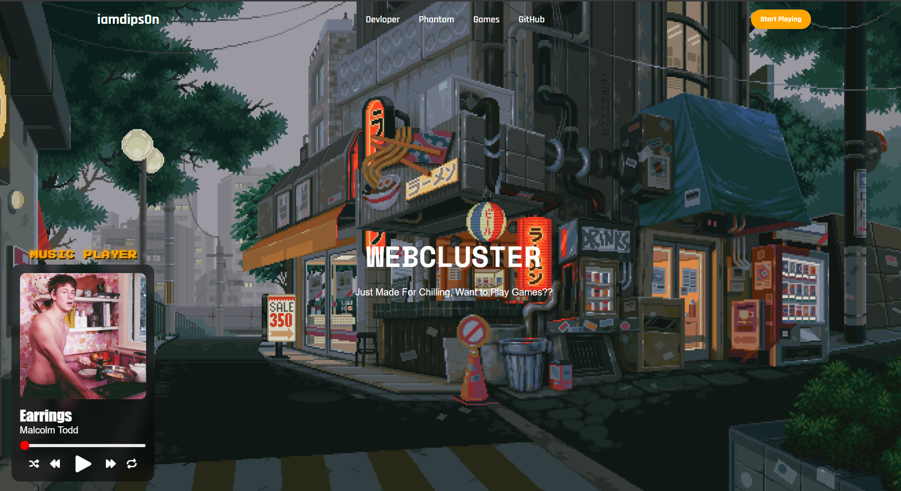
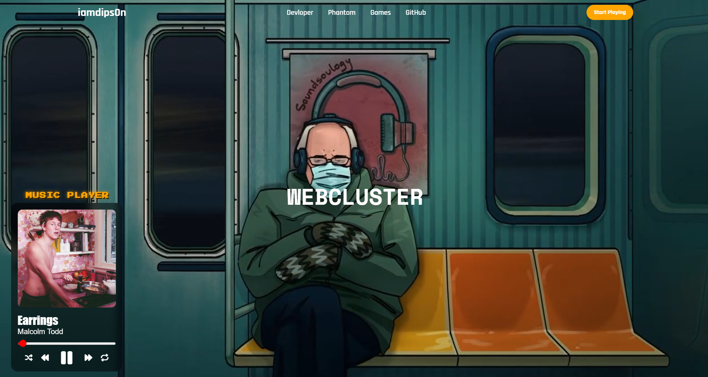
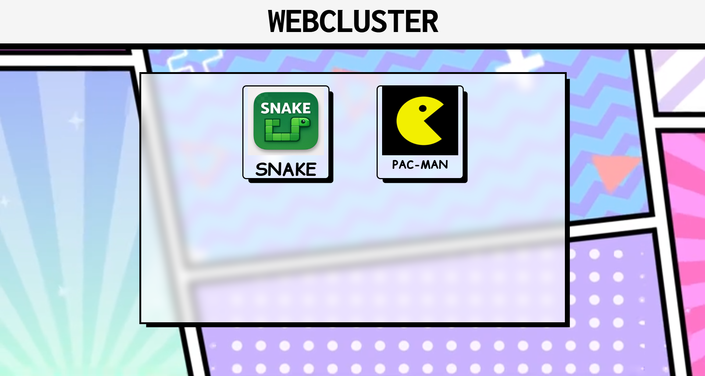
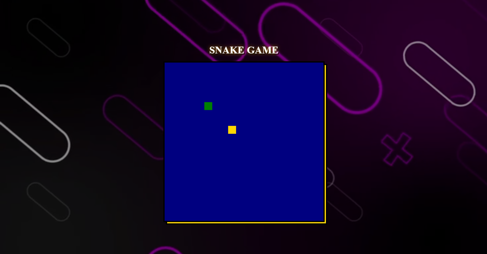
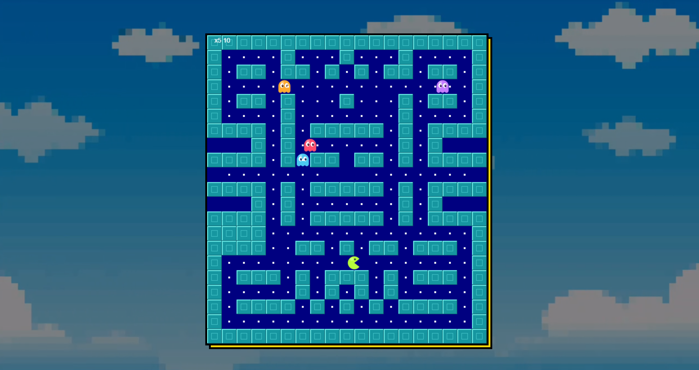

# WEBCLUSTER
### WebCluster is a web based project having a pixel-art cool dashboard with a built-in music player which plays the music and a games hub where you can play Snake and Pac-Man game in your browser within the website. It is built with plain HTML, CSS and JavaScript.
### Here's the web link
[Click here](https://iamdips0n.github.io/WEBCLUSTER/dashboard)

### Here's the image of the main page

### Now when you play the music from music player it changes!!

### When You click the games button or Start Playing button
# The Game Menu

### The currently available games are :

# Snake
### Snake is a one of the classic game where a small body of snake moves around a grid where it is guided towards yellow point where the snake touches or eats the shiny yellow golden points and gets fat (He actually gets longer) and player play until the full board is filled with our snake. The game is currently desktop supported only. This game has soundeffects also, for when you die and for when you click.

### Controls: arrowUp (UP), ArrowLeft (Left), ArrowDown (Down), ArrowRight (RIGHT), Space (Start / Re-start)

## Pac-Man

### Pac-Man is one of the classic games where a small hungry yellow guy runs around a maze, avoiding the ghost and eating yellow points. You get 5 lives, and every time a ghost kisses you or touches you LOL, you lose one life. Eat all the dots in the maze to complete the game. The game is currently desktop supported only. This game has sound effects too!!! WOOOOW one for when a ghost catches you, a moving video background to give it a retro gaming feel.!!

### Controls: ArrowUp / W (Up), ArrowLeft / A (Left), ArrowDown / S (Down), ArrowRight / D (Right), Any key (Re-start after game over)

